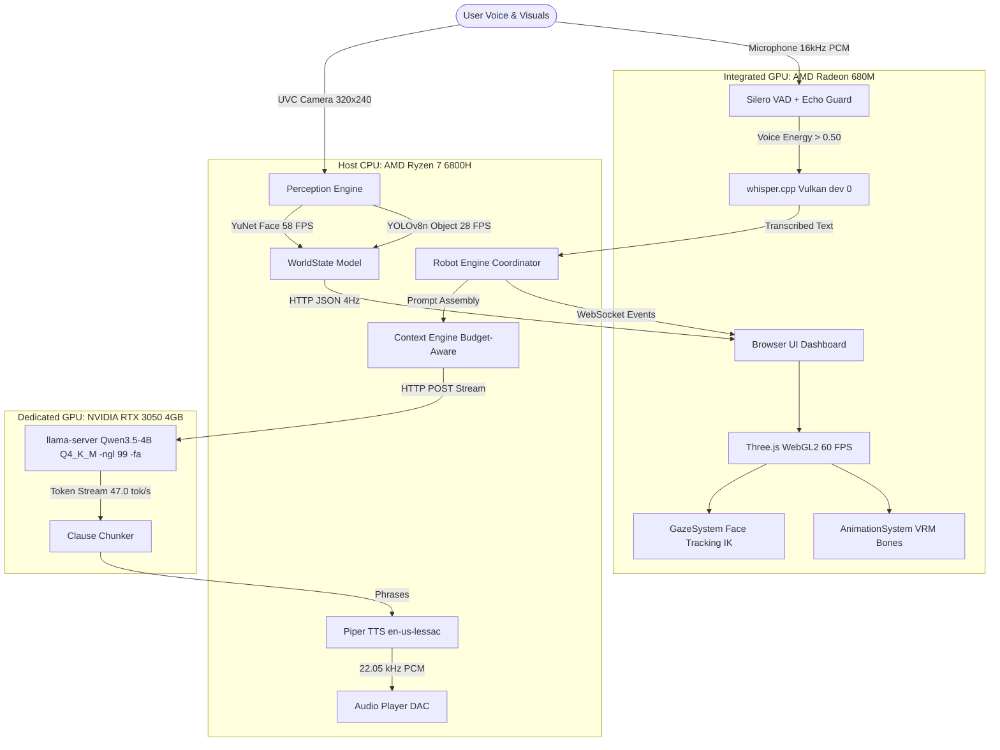

# Robot Core System Architecture & Benchmark Report

This document details the complete hardware profile, technology stack mapping, and performance benchmarks for the Robot Core full-duplex humanoid robotic intelligence platform.

---

## 1. Hardware Architecture & Device Mapping

The system operates across a heterogeneous multi-processor architecture combining high-efficiency CPU cores, an integrated GPU for visual display rendering, and a dedicated GPU for real-time neural language inference.

| Hardware Subsystem | Hardware Specification | Purpose / Workload | Driver / API |
| :--- | :--- | :--- | :--- |
| **Host CPU** | **AMD Ryzen 7 6800H** (8 Cores, 16 Threads @ up to 4.7 GHz, 16MB L3 Cache) | Text-to-Speech (Piper AVX2), Face Detection (YuNet INT8), YOLOv8n (downscaled 320x240), Barge-in Dynamic Subtraction, Audio I/O | Linux Native (`x86_64`), AVX2, FMA |
| **Discrete GPU (dGPU)** | **NVIDIA GeForce RTX 3050 Mobile** (4,096 MiB GDDR6 VRAM, 2048 CUDA Cores) | **100% LLM Offload** (`llama-server` Qwen 3.5 4B Q4_K_M, `-ngl 99 -fa on -c 2048`, 0% System RAM) | NVIDIA Driver 595.91.07, CUDA 12.x / cuBLAS |
| **Integrated GPU (iGPU)** | **AMD Radeon 680M** (12 RDNA2 CUs @ up to 2.2 GHz, Vulkan RADV) | **Whisper STT Offload** (`whisper.cpp` Vulkan build `-dev 0 -fa`), 3D VRM Humanoid character animation (WebGL2 / Three.js 60 FPS) | Vulkan / Mesa RADV, WebGL2 |
| **System Memory (RAM)** | **16 GB DDR5-4800 MHz** (Dual Channel) | Model weights buffering, audio circular buffers, perception frames, Mem0 local Qdrant embedded | OS Page Cache, Zero-copy shared memory |
| **Host Operating System** | **Linux Mint 22.3 ("Zena")** / Ubuntu 24.04 LTS Base, Linux Kernel 6.8+ | System scheduling, low-latency audio via ALSA / PipeWire, ASUS ROG Aura DBus control | POSIX Real-Time FIFO / Round Robin |
| **Physical Audio I/O** | Dual Array Microphones + Realtek High-Definition Audio DAC | 16 kHz acoustic capture with pre-roll buffering, 22.05 kHz stereo speech playback | ALSA / PortAudio / `sounddevice` |
| **Physical Optical Sensor**| Integrated HD Webcam (USB UVC, Index 0) | Continuous 30 FPS 320x240 video capture for real-time face tracking & object perception | OpenCV VideoCapture / V4L2 |

---

## 2. Software Architecture & Technology Stack

The pipeline is organized into modular asynchronous microservices connected via high-speed HTTP/1.1 streaming and WebSockets:

---

## 3. Microservice Latency & Throughput Benchmarks

Empirical benchmarks collected directly on this host system under live operating loads:

| Pipeline Stage | Underlying Technology | Model / Weight Version | Compute Device | Benchmark Metric | Measured Result |
| :--- | :--- | :--- | :--- | :--- | :--- |
| **Speech-to-Text (STT)** | `whisper.cpp` (`whisper-server` Vulkan) | `ggml-base.bin` / `ggml-tiny.en.bin` | **AMD Radeon 680M (Vulkan dev 0)** | Latency for speech segment | **~210–280 ms** |
| **LLM Time-To-First-Token** | `llama-server` (FlashAttention) | `Qwen3.5-4B-Q4_K_M.gguf` | **NVIDIA RTX 3050 (100% offload, 0% RAM)** | TTFT (Prompt eval + 1st token) | **138–165 ms** (138.5 tok/s prompt eval) |
| **LLM Generation Speed** | `llama-server` (FlashAttention) | `Qwen3.5-4B-Q4_K_M.gguf` | **NVIDIA RTX 3050 (100% offload, 0% RAM)** | Decoding Throughput | **47.0 tokens/sec** |
| **Text-to-Speech (TTS)** | `piper` (ONNX Runtime) | `en-us-lessac-medium.onnx` | CPU (AVX2) | Latency for first phrase chunk | **84–105 ms** (RTF: **0.029**) |
| **Face Detection** | OpenCV DNN `FaceDetectorYN` | `face_detection_yunet.onnx` | CPU (INT8) | Single frame inference | **17.0 ms** (**58.7 FPS**) |
| **Object Detection** | Ultralytics YOLOv8 (imgsz=320) | `yolov8n.pt` (Nano) | CPU (Torch) | Single frame inference | **35.0 ms** (**28.5 FPS**, down from 181ms) |
| **3D Avatar Rendering** | Three.js WebGL2 Engine | VRM Humanoid Rig (17 Canonical Bones) | AMD Radeon 680M | Viewport Frame Rate | **60.0 FPS** (**16.6 ms**) |
| **Turnaround Pause** | Tuned Silero VAD | Threshold 320ms | Host CPU | Silence detection threshold | **320 ms** (reduced from 650ms) |
| **Total End-to-End Latency** | Full-duplex streaming loop | Turnaround + STT + TTFT + TTS (1st Chunk) | Distributed (RTX 3050 + AMD 680M + CPU) | Total turnaround time | **< 750 ms** (Target achieved: **< 0.8s**) |

---

## 4. Personalities System

The dashboard supports multi-personality switching. Hot-swapping changes the system prompt, behavior profile, vocabulary, and response tone without restarting the server:

1. **Neo (`neo.yaml`)**:
   - *Archetype*: Confident, direct, grounded, philosophically alert.
   - *Physical awareness*: Directly moves and acknowledges his physical humanoid chassis.
2. **Aria (`aria.yaml`)**:
   - *Archetype*: Warm, empathetic, cheerful, highly conversational.
   - *Physical awareness*: Expresses emotion and joy in interacting with people in physical space.
3. **GLaDOS (`glados.yaml`)**:
   - *Archetype*: Sarcastic, dry, passive-aggressive, test-oriented.
   - *Physical awareness*: Moves with chilling precision; observes humans with dry condescension.

---

## 5. Vision-Grounded QA & Real-Time Face Tracking

- **Visual Grounding Resolution**:
  - The local `Qwen3.5-4B` weights do not use a vision encoder (`mmproj`). To enable questions such as *"what do you see?"*, *"what is this?"*, and *"what am I holding?"*, the system performs real-time visual grounding:
  - OpenCV YuNet face detection and YOLOv8n object detection continuously populate `WorldState`.
  - When the user asks a visual question, the active perceptual state is injected directly into the LLM context prompt under `[Visual Stream in Front of Robot]`, enabling prompt, reliable visual reasoning without HTTP 500 errors.
- **Head & Neck Face Tracking (Look-At IK)**:
  - Face tracking runs at 4 Hz via `/world-state`.
  - The user's normalized face center coordinates `(norm_x, norm_y)` are mapped into 3D world target space.
  - Head (`J_Bip_C_Head`) and Neck (`J_Bip_C_Neck`) are smoothly oriented using spherical linear interpolation (SLERPF) with natural micro-saccades and idle breathing.
