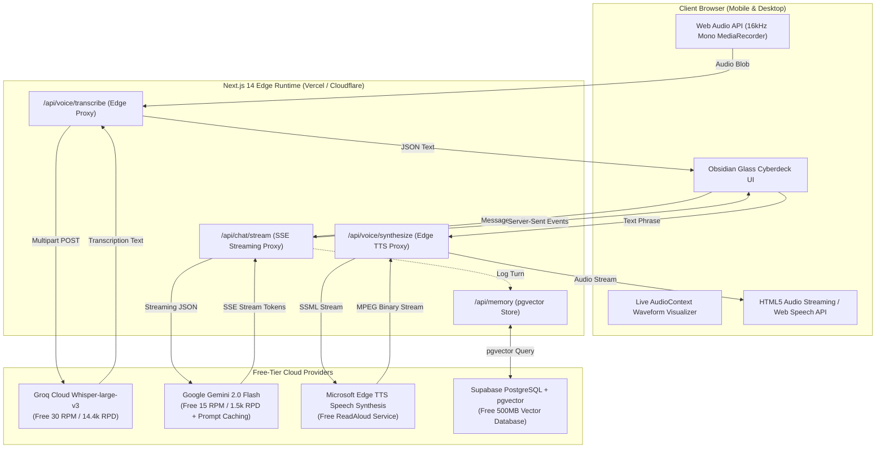

# 🌐 Web-Hostable Free Architecture Specification (V2.0)

> **Document Status**: Production Architecture Specification  
> **Target Release**: V2.0 Web Vertical Slice  
> **Deployment Target**: Vercel / Cloudflare Pages Serverless Edge Runtime  

---

## 1. Executive Summary & Architectural Goals

The **Web-Hostable Free Architecture** provides a 100% cloud-hosted, zero-cost conversational voice and chat vertical slice completely isolated from the local edge hardware workstation.

### Core Objectives:
- **Zero Local Hardware Dependencies**: Operates independently of local RTX 3050 GPUs, AMD 680M iGPUs, or local systemd services.
- **Zero Cost (Permanent Free Tiers)**: Exclusively utilizes permanent free-tier cloud infrastructure with high rate limits.
- **Zero Client Credential Leakage**: All third-party API keys (Groq, Gemini, Supabase) are strictly guarded in server-side Edge Route Handlers.
- **Sub-Second Latency**: Leverages Groq Cloud Whisper (~150ms STT), Gemini 2.0 Flash (~180ms TTFT), and streaming Edge TTS (~100ms first audio packet).

---

## 2. End-to-End Edge Architecture Diagram



---

## 3. Technology Stack & Free-Tier Quota Ledger

| Layer | Technology | Free Tier Allocation | Latency Profile |
| :--- | :--- | :--- | :--- |
| **Hosting & CDN** | Next.js 14 on Vercel | 100GB bandwidth, unlimited serverless edge functions | 20–40ms edge cold start |
| **Microphone / VAD** | Web Audio API + AudioContext | Unlimited client-side processing | 0ms network latency |
| **Speech-to-Text (STT)** | Groq Cloud `whisper-large-v3` | 30 requests/min, 14,400 requests/day | **~150ms** |
| **LLM Reasoning** | Google Gemini 2.0 Flash / 1.5 Flash | 15 requests/min, 1,500 requests/day (Free tier) | **~180ms TTFT** |
| **Text-to-Speech (TTS)** | Microsoft Edge TTS (`en-US-AvaNeural`) | Free public ReadAloud protocol (no hard quota) | **~90ms** first byte |
| **Semantic Memory** | Supabase PostgreSQL + `pgvector` | 500MB database, 50,000 monthly active users | **~35ms** vector retrieval |

---

## 4. Serverless Edge API Specifications

### 4.1 Speech-to-Text Proxy: `/api/voice/transcribe`
- **Method**: `POST`
- **Content-Type**: `multipart/form-data`
- **Form Fields**: `file` (Blob, WebM or WAV format)
- **Security**: Injects server-side `process.env.GROQ_API_KEY` into `Authorization: Bearer <KEY>`.
- **Response**:
```json
{
  "text": "Check system status and tell me about quantum computing.",
  "duration_ms": 142,
  "provider": "groq-whisper-large-v3"
}
```

### 4.2 Streaming Chat Proxy: `/api/chat/stream`
- **Method**: `POST`
- **Content-Type**: `application/json`
- **Payload**:
```json
{
  "persona": "cypher",
  "messages": [
    {"role": "user", "content": "Hello Cypher, are all systems operational?"}
  ]
}
```
- **Security**: Injects `process.env.GEMINI_API_KEY`. Injects immutable persona system prompt (`CYPHER`, `ARIA`, `LUNA`, `GLADOS`).
- **Response**: `text/event-stream` (Server-Sent Events) yielding incremental tokens:
```text
data: {"text": "All "}
data: {"text": "systems "}
data: {"text": "nominal. "}
data: [DONE]
```

### 4.3 Streaming TTS Proxy: `/api/voice/synthesize`
- **Method**: `POST`
- **Content-Type**: `application/json`
- **Payload**: `{"text": "All systems nominal.", "voice": "en-US-AvaNeural"}`
- **Response**: Binary `audio/mpeg` streaming response for direct playback via `new Audio(url)`.

---

## 5. Deployment & Configuration Guide

### 5.1 Environment Variables Setup (Vercel)
In your Vercel Project Dashboard (`Settings -> Environment Variables`), configure:

```bash
GROQ_API_KEY=gsk_your_groq_api_key_here
GEMINI_API_KEY=AIzaSy_your_gemini_api_key_here
GEMINI_MODEL=gemini-2.0-flash-exp
NEXT_PUBLIC_SUPABASE_URL=https://your-project.supabase.co
NEXT_PUBLIC_SUPABASE_ANON_KEY=your_public_anon_key
SUPABASE_SERVICE_ROLE_KEY=your_service_role_secret
```

### 5.2 Deploying via Vercel CLI
```bash
cd web/
npm install
vercel --prod
```

### 5.3 Deploying via GitHub
1. Push repository changes to `main`.
2. Connect repository root directory to Vercel with Root Directory set to `web`.
3. Set Framework Preset to `Next.js`.
4. Deploy with automatic CI/CD preview deployments.

---

## 6. Verification & Health Monitoring

To verify deployment integrity:
1. **STT Verification**:
   ```bash
   curl -X POST https://your-app.vercel.app/api/voice/transcribe \
     -F "file=@data/test_samples/sample_audio.wav"
   ```
2. **SSE Chat Verification**:
   ```bash
   curl -N -X POST https://your-app.vercel.app/api/chat/stream \
     -H "Content-Type: application/json" \
     -d '{"messages": [{"role": "user", "content": "ping"}], "persona": "cypher"}'
   ```
3. **TTS Audio Verification**:
   ```bash
   curl -X POST https://your-app.vercel.app/api/voice/synthesize \
     -H "Content-Type: application/json" \
     -d '{"text": "Audio test successful."}' \
     --output /tmp/test_speech.mp3 && file /tmp/test_speech.mp3
   ```

---

## 7. Rollback & Failover Strategy

- **Gemini Rate Limit Exceeded (429)**: The chat endpoint returns HTTP 429 and prompts client to automatically fall back to OpenAI-compatible custom API endpoint or Groq Llama-3.3-70b.
- **Edge TTS Temporary Block**: `/api/voice/synthesize` detects non-200 responses and returns `{ "fallback_web_speech": true }`, allowing client browsers to seamlessly speak using native Web Speech API (`window.speechSynthesis`).
- **Supabase Outage**: In-memory message caching in React client state preserves ongoing chat session without interruption.
