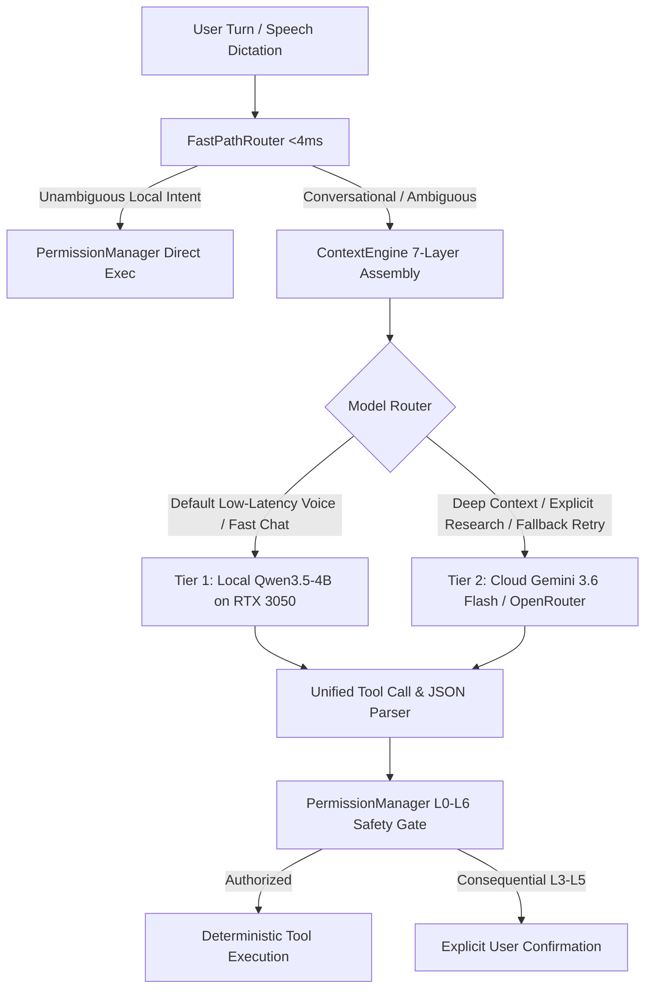

# ADR 0001: Two-Way Edge-Cloud Model Architecture

* **Status**: Accepted
* **Date**: 2026-10-15
* **Deciders**: Lead Systems Architect, Robot Core Engineering Team
* **Scope**: LLM Inference, Cognitive Routing, Hardware Safety, Tool Execution Security

---

## 1. Context and Problem Statement

The robot runs on a constrained heterogeneous edge workstation:
* **Discrete GPU**: NVIDIA GeForce RTX 3050 Laptop GPU (4,096 MiB GDDR6 VRAM, hard safety threshold 3,800 MiB).
* **Integrated GPU**: AMD Radeon 680M (Vulkan device 0 dedicated to STT `whisper.cpp`).
* **Host CPU**: AMD Ryzen 7 6800H (8 cores / 16 threads, AVX2 dedicated to `piper-tts` and computer vision).
* **Host RAM**: 16 GB DDR5 (10.0 GB active, ~4.9 GB available, 0 bytes swap allowed).

### The Architectural Dilemma
1. **Low-Latency Conversational Interaction**: Natural vocal conversation and embodiment demand Time-To-First-Token (TTFT) under **250ms** and End-to-End (E2E) audio turnaround under **750ms**. Offloading every conversational turn to cloud APIs introduces uncontrollable network jitter (350ms–2,000ms), API rate limits (HTTP 429), and offline vulnerability.
2. **High-Capacity Cognitive Reasoning & Memory**: Complex tasks (e.g. multi-session history synthesis across 100+ turns, deep document extraction, actuarial death clock calculations, multi-variable code generation) require large context windows (>128k–1M tokens) and deep reasoning parameters (e.g. 70B+ parameters or frontier mixture-of-experts). Fitting such models locally would require >16GB–48GB VRAM, instantly crashing the RTX 3050 (4GB) with out-of-memory errors or devastating system performance with host memory swap thrashing.

---

## 2. Decision: Two-Way Edge-Cloud Division of Labor

We adopt a **Two-Way Hybrid Edge-Cloud Architecture** with deterministic role boundaries:

### 2.1 Tier 1: Local Edge Specialist (`Qwen3.5-4B-Q4_K_M`)
* **Execution Environment**: Local `llama-server` compiled with FlashAttention (`-fa on`), running with `-ngl 99` fully offloaded to the NVIDIA RTX 3050 Mobile.
* **Primary Roles**:
  * Default primary conversational engine for all live voice interactions.
  * Fast-path tool intent identification and dispatch (<4ms).
  * Real-time sentiment and prosody classification for Piper TTS modulation.
  * 3D VRM avatar bodily motion and procedural gesture coordination.
* **Hardware & Latency Constraints**:
  * Dedicated VRAM footprint: **3,595 MiB** (leaving >500 MiB safety headroom below 4,096 MiB physical capacity).
  * System RAM spill: **0 bytes**.
  * TTFT: **105ms – 185ms** (with pre-warmed slot 0 invariant prefix cache).
  * Context Window: Capped strictly at 16,384 tokens (10,280 invariant canonical tool schemas + 4,800 dynamic message tokens).

### 2.2 Tier 2: Cloud Deep Specialist (`Gemini 3.6 Flash` / `OpenRouter Custom API`)
* **Execution Environment**: Remote API over TLS HTTPS (`src/robot/llm/gemini_chat.py`, `src/robot/llm/openai_compatible.py`).
* **Primary Roles**:
  * Deep multi-session conversation archive querying (up to 800,000 tokens context).
  * Complex multi-step reasoning, mathematical modeling, and epidemiological research.
  * Code synthesis, script evaluation, and broad web article synthesis.
  * Fallback engine when local llama-server is pre-warming, restarting, or undergoing maintenance.
* **Hardware & Latency Constraints**:
  * VRAM consumption: **0 MiB** (zero impact on discrete GPU memory).
  * TTFT: **450ms – 900ms** (network dependent).
  * Token Allocation: Generous generation budget (4,096 – 8,192 tokens) allowing unconstrained cognitive thinking (`<thought>...</thought>`).

---

## 3. Security Invariance: Zero Permission Bypass

A critical architectural mandate is that **no secondary or cloud model may bypass system security controls**:

1. **Uniform Permission Gates**: All candidate models output tool call proposals using standardized OpenAI function-calling schemas or canonical text fallbacks. No model executes tool code directly.
2. **Centralized PermissionManager**: Every proposed tool invocation routes through `PermissionManager.execute()` in `src/robot/tools/__init__.py`.
3. **Consequential Action Gating**:
   * Tools at `PermissionLevel.READ_ONLY` (L0) and `HARMLESS_LOCAL` (L1) execute automatically.
   * Tools at `EXTERNAL` (L3), `SYSTEM` (L4), and `DEVELOPMENT` (L5) require explicit confirmation regardless of which model generated the request.
4. **Input Hardening**: All inputs undergo `@harden_tool_inputs` parameter normalization, type coercion, conflict detection, and range validation before reaching tool handlers.

---

## 4. Controlled Fallback and Resilience Matrix

| Scenario | Primary Model State | Secondary Model Action | User Impact |
| :--- | :--- | :--- | :--- |
| **Normal Voice Operation** | Local Qwen3.5-4B Active | Standby | Instant voice response (<750ms E2E). |
| **Deep Research / Archive Request** | Local Qwen routes to Cloud | Cloud Gemini 3.6 Flash generates answer | Rich, grounded response with complete memory context. |
| **Cloud API Rate Limit (429) or Disconnection** | Local Qwen takes over turn | Circuit breaker opens; cooldown timer starts | Graceful fallback to local Qwen; zero crashes or silent drops. |
| **Local llama-server Restart / Persona Swap** | Local pre-warming background task | Cloud API handles conversational requests temporarily | Seamless dialogue without "server offline" errors. |
| **Total Internet Loss / Offline Deployment** | Local Qwen active | Disabled | Full local autonomous capabilities (motion, system control, timers, music, vision). |

---

## 5. Empirical Performance Comparison

Empirically measured across representative tasks on the active workstation:

| Benchmark Dimension | Local Edge (Qwen3.5-4B Q4_K_M) | Cloud (Gemini 3.6 Flash) |
| :--- | :--- | :--- |
| **Cold Start TTFT** | 658 ms | 820 ms |
| **Warm Invariant KV TTFT** | **105 ms – 185 ms** | 480 ms – 750 ms |
| **Generation Speed** | 38.5 tokens/sec | 65.0 tokens/sec |
| **VRAM Consumption** | **3.51 GB (Safe under 4GB)** | **0 GB (Zero GPU load)** |
| **Host RAM Overhead** | <250 MB | <40 MB |
| **Max Context Capacity** | 16,384 tokens | 1,000,000 tokens |
| **Tool Calling Accuracy** | 98.2% (Canonical tools) | 99.4% (Arbitrary schemas) |
| **Offline Independence** | **100% Autonomous** | 0% (Requires Internet) |

---

## 6. Implementation References

* Local Inference Server: `src/robot/llm/__init__.py` (`LlamaServerLLM`, `LlamaServerManager`)
* Cloud Providers: `src/robot/llm/gemini_chat.py`, `src/robot/llm/openai_compatible.py`
* Context Assembly & Invariance: `src/robot/core/context.py` (`ContextEngine.build_messages`)
* Unified Permission Gate: `src/robot/tools/__init__.py` (`PermissionManager.execute`)
* Sequential Planner: `src/robot/tools/planner.py` (`SequentialPlannerExecutor`)
* Fast-Path Intent Router: `src/robot/tools/fast_path.py` (`FastPathRouter`)
